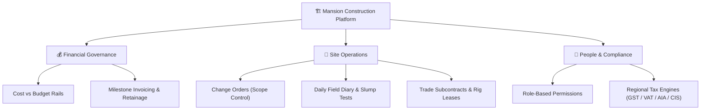

# Welcome to Mansion

**Mansion** is a construction management and financial control platform designed for general contractors, site engineers, project managers, and builders. It gives everyone on the team a single, shared source of truth for site progress, project costs, contracts, and billing.

Whether you are wearing safety boots on the job site logging worker headcounts or reviewing profit margins in the office, Mansion simplifies the daily running of construction projects.

---

## What Mansion Does (In Plain English)

Construction projects usually struggle with three common challenges:
1. **Losing track of extra work**: Changes happen on site daily, but if they aren't written down and approved, the builder ends up paying for them out of pocket.
2. **Cash flow blind spots**: Knowing whether you have spent more money than the client has paid you, and tracking how much security money (retainage) is being held back.
3. **Disconnected site records**: Paper diaries and chat group messages get lost when disputes arise about weather delays or concrete quality.

Mansion solves these challenges with three core pillars:

---

## Key Terms Explained for Laymen

If you are new to commercial construction or accounting, here is a quick cheat sheet for terms used across this guide:

| Term | What it Means in Everyday Terms | Why It Matters |
| :--- | :--- | :--- |
| **Retainage (or Retention)** | A small percentage (typically 5% to 10%) held back from payment until the building is finished and defect-free. | Protects the client against poor workmanship; ensures subcontractors return to fix any defects during the warranty period. |
| **Change Order (Variation)** | A formal written agreement to alter the original project plan, price, or deadline. | Prevents "scope creep." Ensures builders get paid for extra work and get extra time if the client changes their mind. |
| **Site Diary (Daily Log)** | A daily record of weather conditions, worker headcount, work completed, and delays. | An ironclad legal log that proves why delays happened (e.g. rainstorms or material shortages). |
| **IPC (Interim Payment Certificate)** | An official bill or progress claim submitted periodically for work actually finished on site. | Replaces guessing with verified milestone billing. |
| **Financing Gap** | The difference between what the builder has spent on materials/labour and what the client has paid so far. | Alerts managers when the company is advancing too much of its own cash before client invoices clear. |
| **Defect Liability Period (DLP)** | The warranty period (usually 6 to 12 months) after building completion. | Retained money is held in escrow until this period ends and all defects are resolved. |

---

## Find Your Guide

Everyone in your company has a specific role in Mansion, meaning you only see the tools and buttons you need:

| If you are a... | What you do most | Recommended Guide |
| :--- | :--- | :--- |
| **Company Owner / Administrator** | Set up company settings, manage team permissions, approve change orders and review financial health | [Administrator Guide](./administration/tenant-setup.md) |
| **Project Manager / Site Superintendent** | Track site diaries, coordinate subcontracts, request change orders, and monitor budget spend | [Manager Guide](./roles/manager.md) |
| **Accountant / Commercial Officer** | Generate milestone invoices, certify trade payment claims, and track retention escrow | [Accountant Guide](./roles/accountant.md) |
| **Auditor / Compliance Inspector** | Review read-only transaction ledgers, verify contracts, and check tax records | [Auditor Guide](./roles/auditor.md) |
| **Client / Stakeholder (Viewer)** | Check overall project milestones and delivery timelines with read-only visibility | [Viewer Guide](./roles/viewer.md) |

:::tip Not sure which role you have?
Check the [Roles at a glance](./roles/overview.md) guide for a side-by-side comparison of who can do what.
:::

---

## Where to Begin

1. **Sign in and set up your profile**: See [Signing in](./getting-started/signing-in.md).
2. **Learn your way around the screen**: See [Finding your way around](./getting-started/navigating-the-app.md).
3. **Explore the core tools**: Visit the [Executive Dashboard](./user-guide/dashboard.md) and [Projects Directory](./user-guide/projects.md).
