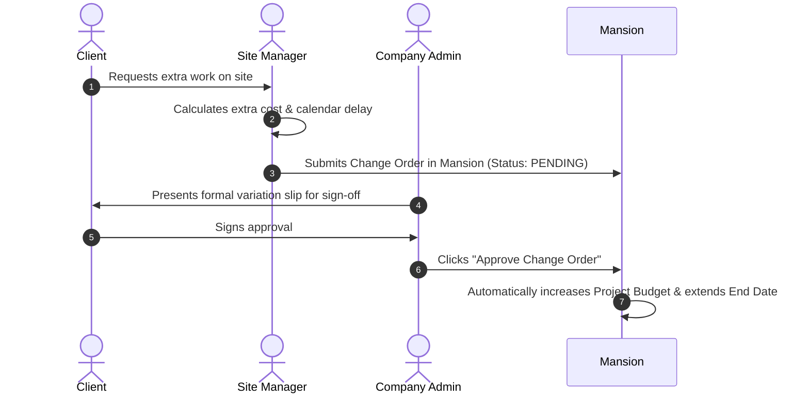

# Change Orders & Scope Variations

In construction, a **Change Order** (also called a *Variation*) is a written agreement to change the original scope of work. 

If a client asks you to add an extra bathroom, upgrade floor tiles to Italian marble, or relocate electrical conduits, a change order records the exact **extra cost** and **extra time** required before any work begins.

:::info Who Can Use This
- **Everyone**: Can view the change order register.
- **Site Managers & Administrators**: Can draft and submit change order requests.
- **Administrators Only**: Have the authority to formally approve or reject change orders.
:::

---

## Visual Overview

---

## Why Change Orders Matter (The Danger of "Scope Creep")

The most common way construction contractors lose money is **unrecorded extra work** (known in the industry as *scope creep*):
1. A client visits the site and informally asks the site engineer: *"Can we move this partition wall two feet to the left?"*
2. The team does the extra demolition and rebuilding work without formal paperwork.
3. At project handover, the client refuses to pay the extra bill because there was no signed agreement, or blames the contractor for finishing three weeks late.

**Mansion eliminates this risk completely**: Every variation is logged in the register, tied to a financial amount and timeline impact, and requires formal sign-off before being incorporated into the project budget.

---

## Understanding the Change Orders Register

The table provides clear, at-a-glance visibility into all requested modifications:

| Column | What It Means | Why It Matters |
| :--- | :--- | :--- |
| **Reference / Code** | Unique identifier (e.g., `CO-2026-001`). | Quoted on all client correspondence, emails, and legal invoices. |
| **Project** | The job site where the variation occurred. | Automatically associates the cost with that project's budget ceiling. |
| **Title & Description** | Summary of the variation (e.g. *Subterranean parking de-watering & waterproofing reinforcement*). | Proves exactly what work was requested and why. |
| **Cost Impact** | The monetary addition or reduction (e.g., `+₹1,25,000`). | Shows the exact additional amount the client will be billed. |
| **Schedule Delay** | The timeline adjustment (e.g., `+14 Days`). | Automatically extends the contractual completion deadline so the contractor is protected from late penalties (liquidated damages). |
| **Status Badge** | `PENDING_CLIENT_APPROVAL`, `APPROVED`, or `REJECTED`. | Informs site teams whether they have permission to start working on the change. |

---

## The Change Order Workflow (Step-by-Step)

1. **Submit Request**: The Site Manager opens **Site Operations → Change Orders**, clicks **+ Request Change Order**, and enters the requested work, extra cost, and days required.
2. **Review & Sign-off**: The Administrator and Client review the impact.
3. **Approval**: When the Administrator clicks **Approve**, Mansion automatically updates the project's **Budget Ceiling** and extends the **Completion Handover Date**.

