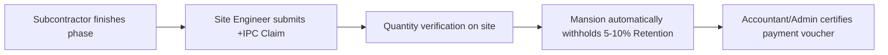

# Subcontracts & Equipment Subleasing

Construction projects rely heavily on specialized trade partners (like electrical contractors and glass fabricators) and rented heavy machinery (such as tower cranes and excavators). 

The **Subcontracts & Subleasing** module brings these commitments into a single ledger so you always know:
1. *How much money you have committed to each subcontractor.*
2. *How much work they have finished and had certified.*
3. *How much retention money is withheld as a defect guarantee.*

:::info Who Can Use This
- **Viewers & Auditors**: Read-only access to agreements and claims.
- **Managers, Accountants & Administrators**: Create trade packages, enter machinery leases, and submit payment claims.
- **Administrators & Accountants**: Authorize and certify Interim Payment Certificates (IPCs).
:::

---

## Visual Overview

---

## Key Metrics at the Top of the Screen

| Metric Card | What it Means for Laymen |
| :--- | :--- |
| **Total Committed Value** | The total contract value agreed across all signed subcontracts and rental agreements (e.g., ₹7,23,500). |
| **Certified to Date** | The cumulative amount of work verified and approved for payment so far (e.g., ₹2,02,000 / 28% delivered). |
| **Retention Withheld** | The total security money (e.g., 5% or 10%) held in escrow until the Defect Liability Period ends. |
| **Active Machinery Leases** | Count of heavy plant machines (cranes, earthmovers, piling rigs) currently rented and accruing hire rates on your sites. |

---

## The Two Types of Agreements

Mansion separates external agreements into two distinct categories:

### 1. 🔨 Trade Subcontracts
- **What they are**: Fixed-scope contracts awarded to specialized trade companies (e.g., HVAC ducting, curtain-wall glazing, electrical wiring, structural waterproofing).
- **Key details tracked**:
  - **Committed Package Value**: The agreed contract price.
  - **Certified Work**: Milestone claims inspected and approved by the site engineer.
  - **Retention Withholding**: Automatic deduction (typically 5% or 10%) kept as insurance against future defects.
  - **Unbilled Remaining**: Contract balance left to be performed.

### 2. 🚜 Equipment Subleasing (Heavy Plant Rental)
- **What it is**: Renting heavy equipment when purchasing machines outright would be too expensive (e.g. *60-Meter Top-Slewing Tower Crane*, *CAT 320 Hydraulic Excavator*).
- **Rental rate options**:
  - **Monthly Lease**: Standard flat rate per calendar month (e.g., ₹8,000/month).
  - **Hourly Meter / Wet Lease**: Billed based on machine operating hours recorded on site, including certified operators and fuel.
  - **Mobilization & Demobilization Fees**: One-time transport and installation fees for bringing the equipment to site and removing it.

---

## How Interim Payment Certificates (IPC Claims) Work

Instead of subcontractors sending informal invoices, Mansion standardizes payments using **Interim Payment Certificates (IPC)**:

1. **Submit Claim**: Click **+ IPC Claim** next to any active contract.
2. **Record Work Completed**: Enter the milestone percentage achieved or volume installed (e.g., 200 meters of piping).
3. **Automatic Retention**: Mansion automatically calculates and deducts the statutory retention percentage, crediting it to the company's retention escrow ledger.
4. **Contra-Charges / Backcharges**: If the subcontractor damaged site property or used contractor supplies (like electricity or diesel), deduct it directly as a contra-charge before certifying.
5. **Certification**: Once certified, the voucher flows directly into the [Invoices & Retainage](./invoicing-and-retainage.md) ledger for payment.

